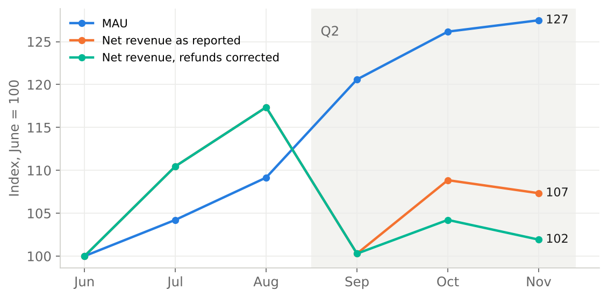
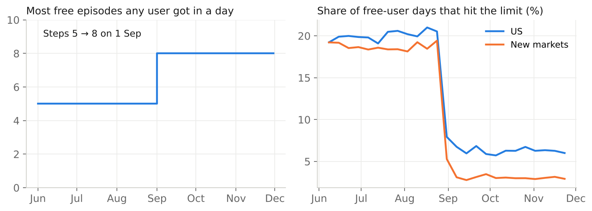
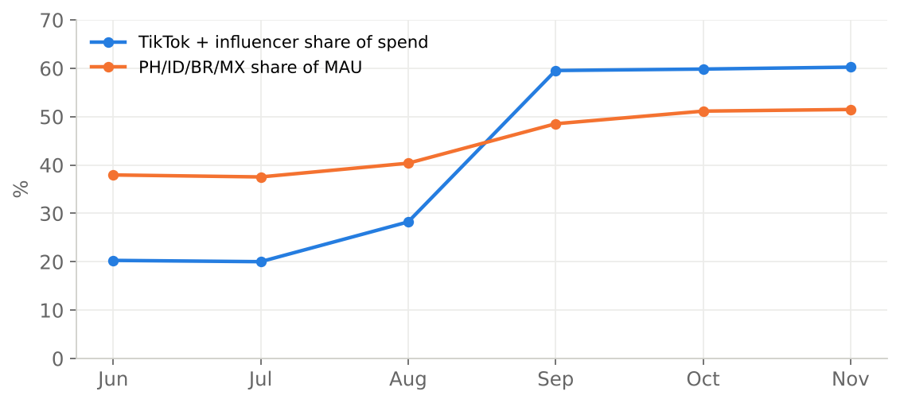
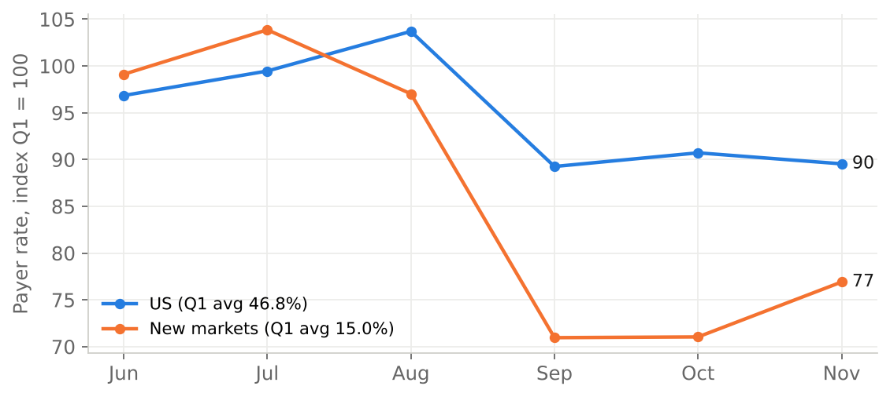
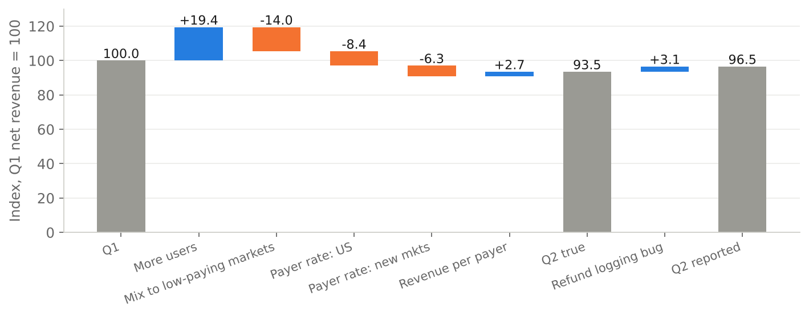
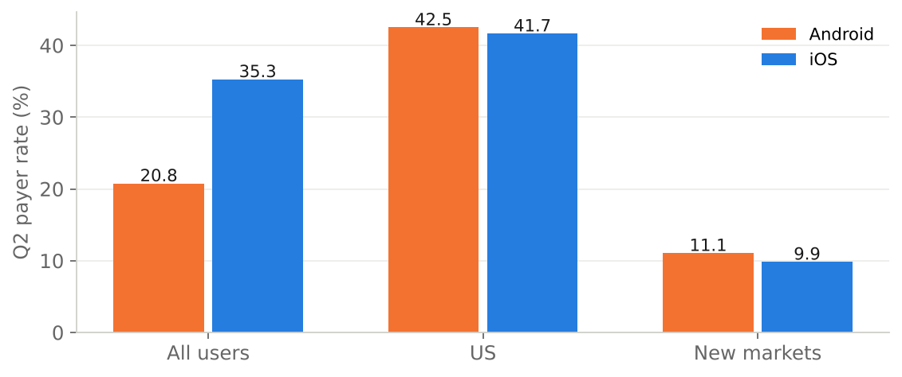

# Revenue isn't flat: it fell 6.5% while MAU grew 19%

**We traded paying users for MAU in two ways, and a logging bug hid part of it.**

- **MAU** 12,466 → 14,888 a month (**+19.4%**) (Q14)
- **Net revenue, as reported** -3.5%; **corrected for a refund logging bug: -6.5%** (Q14, Q4)
- **Revenue per MAU** $2.67 → $2.09 (**-22%**) (Q28)
- **Cause 1:** the daily free-episode allowance went from 5 to 8 on 1 Sep. Far fewer people reach the paywall, so payer rates fell in every market, including the US (Q16, Q17, Q18)
- **Cause 2:** from mid-August, acquisition budget moved to TikTok and influencers, which bring mostly PH/ID/BR/MX users who pay about a third as often at the same $9.99 (Q19, Q28)
- **Ask for Thursday:** restate Q2 revenue, test the free allowance, and judge channels by cost per paying user, not cost per install

Data: 1 Jun – 30 Nov 2026. Q1 = Jun–Aug, Q2 = Sep–Nov. Query IDs (Qn) are listed in the evidence appendix.

---

## MAU climbed from September; revenue didn't follow

- Q2 MAU averaged 14,888 vs 12,466 in Q1. Reported Q2 revenue $96,472 vs $99,928; corrected $93,411 (Q14)
- The gap opens in **September**, not gradually: something changed at the start of the quarter

---

## First, the number was wrong: Google Play refunds are logged as income

- The data dictionary says refunds are stored as negative amounts. Checked, not trusted: **234 of 234 Google Play refunds from 2026-10 are positive**; every other method and month is negative (Q4, Q15)
- Effect: reported Q2 net revenue is **overstated by $3,061 (3.1 points)**, turning a -6.5% decline into -3.5% that reads as "flat"
- Refund **rates** are normal; only the sign is wrong. Other checks passed: 121 duplicate charge pairs (same user/type/amount within 5 min) (noise, Q6), failed charges steady at 3.5%–3.8% by method (Q24), only list prices $9.99 / $0.99 / $1.99 (Q27), no gaps in recent data
- **Fix:** restate Q2, correct the billing integration, and keep the new data test (`assert_refunds_negative`) in the daily pipeline: it fails today

---

## Cause 1: the free allowance rose from 5 to 8 on 1 Sep

- No one is told this in the data dictionary; it shows as a step in the most free episodes any user watched in a day (Q16)
- Free users hitting the limit: **US 20% → 6% of their days; new markets 19% → 3%** (Q17)
- Once people hit the paywall they buy as often as before (US 0.582 → 0.637, new markets 0.090 → 0.096 purchases per hit): **fewer reach it, not a worse paywall**
- Side effects: $0.99 unlock revenue **-64%**; D30 retention fell overall (13.1% Jun → 12.2% Sep cohort), a mix shift (new markets 10.5% → 11.8%, US 14.9% → 13.3%): MAU grew from signups, not retention (Q25, Q21)

---

## Cause 2: budget moved to cheap installs in low-paying markets

- TikTok + influencer share of spend: **20% → 60%** from mid-August, total budget flat (Q19)
- New markets' share of MAU: **39% → 50%**; they pay 14.9% vs 46.8% in the US (Q1) at the same $9.99 (Q28)
- Cheapest install ≠ cheapest payer: **tiktok_ads** has the lowest CPI ($3.65); **google_ads** the lowest cost per paying user ($33); **influencer** the highest ($41) (Q20)

---

## The two causes compound: new markets lost twice as much

- **US payer rate 46.8% → 42.0% (-10%)**. US mix barely moved, so this is the clean read of the allowance change (control) (Q28)
- **New markets 14.9% → 10.9% (-27%)**: their viewing rarely exceeds 8 episodes a day, so the higher allowance removed most of their paywall moments (Q17)
- Inference (not in the data): both moves served a MAU goal. Worth confirming with the growth and product owners

---

## Bridge: where the revenue went (Q1 = 100)

Sequential substitution by market (Q28): volume → mix → payer rate → revenue per payer; residual -0.0. "More users" is mostly cause 2 acquisition (new signups). "Revenue per payer" rose because the payers lost were mostly light $0.99 buyers; subscription price is unchanged. Swapping the mix and rate steps moves each by about half a point.

---

## Ruled out: Android checkout, content, prices, payments

- **"Android checkout is broken"**: Android payer rate is far below iOS overall, but close within each market. Android users are mostly in new markets: **a mix effect** (Q22, Q23); failure rates similar by method (Q24)
- **Content got weaker**: completion steady at 60%–60%; premium-episode revenue +19% (Q26, Q25)
- **Price or currency changes**: only $9.99 / $0.99 / $1.99 (Q27). **Subscription revenue** -3.8%: the base held; the loss is new payers and unlocks

---

## Recommendations

| # | Action | Owner | What's at stake | How we'll know |
|---|---|---|---|---|
| 1 | Restate Q2 (-6.5%, not -3.5%); fix Google Play refund logging; keep the daily refund-sign test | Finance + Data eng | 3.1 pts of reported revenue | Test passes daily; reconciles with store payouts |
| 2 | A/B test the free allowance (5 / 6 / 8), including a lower limit in new markets | Product | Payer-rate step -14.7 pts vs any engagement gain | Net revenue per MAU and D30 per arm, 4 weeks |
| 3 | Judge channels by cost per paying user and payback; cap the worst until it pays back | Growth | influencer $41 vs google_ads $33 per payer | Cost per payer, 90-day payback by channel |
| 4 | Test regional pricing or a weekly plan in PH/ID/BR/MX | Pricing | New markets pay ~⅓ as often at $9.99 | Payer rate and revenue per MAU vs control countries |
| 5 | Put paying users and revenue per MAU beside MAU in the board pack | GM | Revenue per MAU -22% | Board pack by segment |

Caveats: before/after with a US control, not an experiment; six months of data limits seasonality checks; competitor activity is not in the data.

---

## How this was produced

- **Agent:** Claude (Opus 5.5) tool-calling loop over a read-only DuckDB warehouse built with dbt; tools for schema, metric catalog (dbt semantic layer), column profiles, guarded SQL, canned data-quality checks, a revenue bridge, and a hypothesis log. Every number must cite a query ID
- **This deck:** numbers computed through the agent's own tools (29 logged queries, see `report/evidence.md`); narrative edited by the analyst. Raw agent output: `outputs/investigation_raw.md` (from `python cli.py --gm`)
- **Eval:** 21 golden questions (simple, filtered, time, cohort, ambiguous, unanswerable, data-quality traps, end-to-end), numeric tolerance + LLM judge; results in `eval/results.md`
